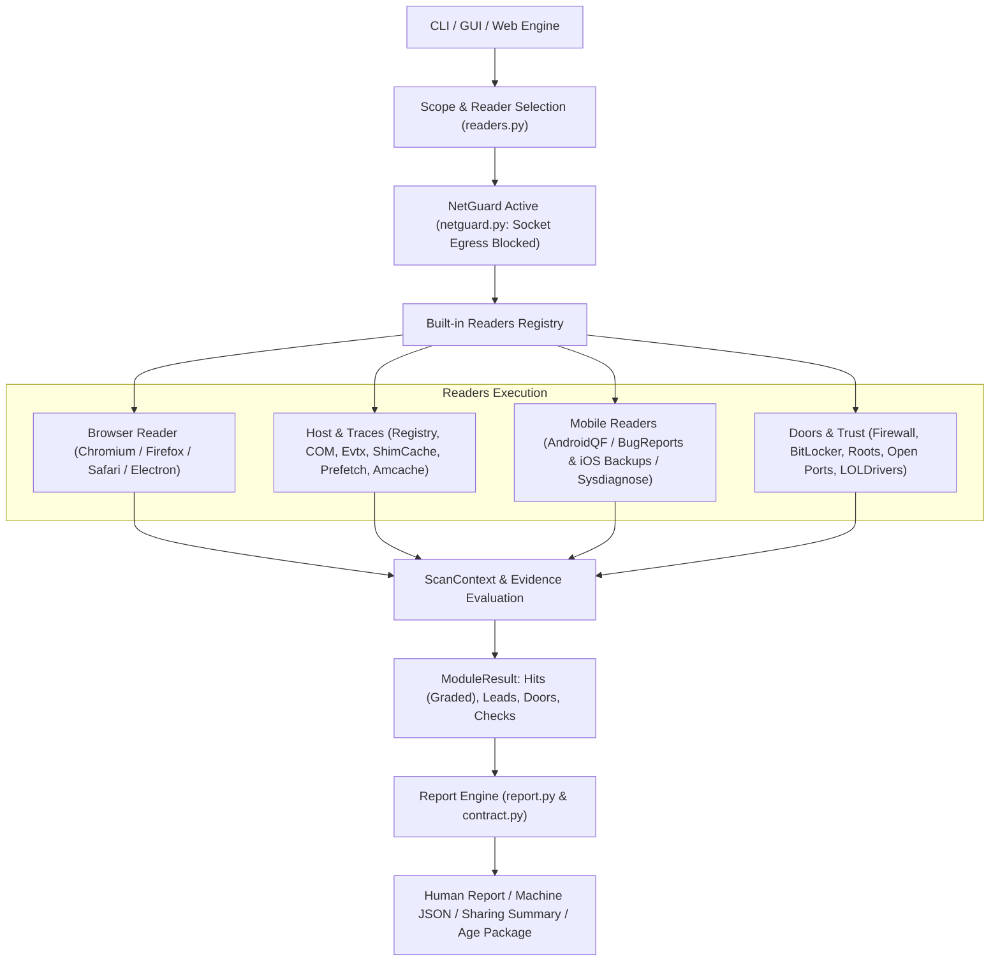
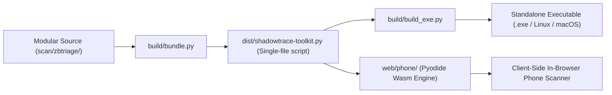
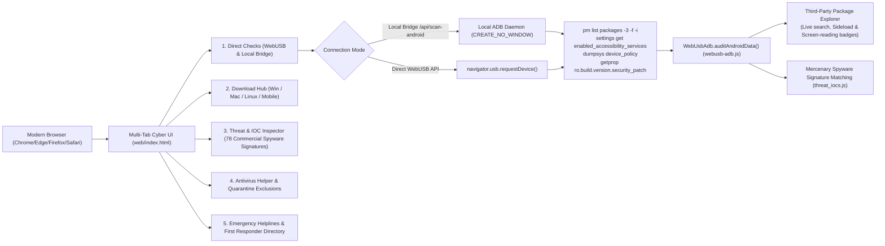

# ShadowTrace Toolkit (formerly Zero Breach Toolkit) — Complete Architectural & Forensic Overview

> [!IMPORTANT]
> **Core Purpose**: ShadowTrace Toolkit is a hardened, free, and open-source digital forensic and security audit utility designed specifically for high-risk individuals (journalists, human-rights defenders, activists, civil society) and forensic first-responders. It detects traces of commercial mercenary spyware (Pegasus, Predator, Candiru/DevilsTongue, Graphite, Dante, Arid Viper, etc.), physical device extractions (Cellebrite), stalkerware, and dangerous device configurations across Windows, macOS, Linux, Android, and iOS.

---

## 1. Architectural Principles & Doctrines

The codebase adheres to strict engineering and operational doctrines to ensure safety, integrity, and credibility:

| Doctrine | Principle | Implementation Mechanism |
|---|---|---|
| **D1: Honest Reporting** | A clean result is **never** presented as proof of safety. | Every report mandates fixed language: `"No known indicators were found in the places that can be checked. This is not a clean bill of health."` |
| **D2: Zero Network Egress** | Never contact, resolve, or ping an indicator under any circumstance. | Runtime enforcement via `netguard.py`: monkey-patches `socket` (`getaddrinfo`, `create_connection`, `connect`, `sendto`, etc.) to raise `NetworkContactAttempt` if triggered. Path checks reject UNC paths and SMB mounts. |
| **D3: Measured, Never Inferred** | `UNKNOWN` and `PARTIAL` are distinct from `CLEAN`. | Every sub-check explicitly reports `.ran()` or `.could_not_run(reason)`. If a database is locked or permissions are denied, the result rolls up to `PARTIAL/UNKNOWN`, never `CLEAN`. |
| **D4: Precision Over Coverage** | Hunches are not findings. | Ambiguous heuristics (e.g. sideloaded apps, unsigned binaries) become **"Worth a Look"** (`Lead`), never triggering false alarms or red verdicts. |
| **D5: Evidence Grading** | The artifact decides the probative weight of a match. | 14 strictly tiered evidence grades (e.g., `on-disk` vs. `referenced` in a cached news article). |
| **D6: Hostile Input Sanitization** | The scanned device is treated as untrusted. | `safetext.py` strips ANSI escapes, terminal control sequences, and bidirectional override characters (LRO/RLO) to prevent terminal cloaking. Paths are validated against directory traversal and symlinks. |
| **D7: Read-Only & Least Privilege** | Scanning never alters system state or requires administrator privileges. | Modules only write temporary copies of SQLite WAL files in a sandboxed temp dir, guaranteed to be cleaned up on exit. |



---

## 2. Evidence Grading System

The scanner distinguishes between actual infection, interaction, and incidental mention:

1. **`on-disk`**: File matches a published cryptographic hash (SHA-256 / SHA-1) of a known malware sample.
2. **`on-device`**: App package, signing certificate, or device setting explicitly attributed to spyware.
3. **`file-pattern`**: Pinned YARA-X rule matched (Candiru rules).
4. **`persistence`**: Indicator registered in auto-start configuration (Run, COM hijack, systemd, LaunchAgent).
5. **`ran-command`**: Indicator executed via command line (Win+R history, PowerShell script block log).
6. **`execution-record`**: Executable name recorded in historical execution log (ShimCache, Prefetch).
7. **`inventory-record`**: Executable recorded in system inventory (Amcache).
8. **`contacted`**: Active bi-directional communication proven (cookie set, HSTS cached, completed download, TLS session).
9. **`device-log`**: System internal log (dumpsys, logcat, sysdiagnose) records the indicator.
10. **`received`**: Unopened message in inbox (SMS, WhatsApp, iMessage) containing a malicious URL.
11. **`dns-record`**: DNS lookup recorded in local cache or event log.
12. **`attempted`**: DNS query blocked by a sinkhole/filter (e.g. `0.0.0.0`), proving contact was avoided.
13. **`configured`**: Malicious IP/domain mapped in configuration (e.g. hosts file).
14. **`referenced`**: String found in browser cache, text file, or bookmark. *(Treated as benign/context: usually a news article about the spyware).*

---

## 3. Core Engine & Forensic Modules (`scan/zbtriage/`)

The core framework is decoupled into a shared execution context (`ScanContext`), a module registry (`readers.py`), and dedicated forensic modules (`zbtriage/modules/`):

### 3.1. Desktop Host & Execution (`host.py`, `traces.py`, `posix.py`, `execution.py`)
- **COM Persistence Hijacking**: Audits per-user `HKCU\Software\Classes\CLSID` registrations pointing to unsigned DLLs in user-writable folders (`%LOCALAPPDATA%`), the exact technique used by Candiru/DevilsTongue.
- **Windows Traces & ClickFix Defense**:
  - Audits `RunMRU` (Win+R history) for PowerShell/mshta download cradles (ClickFix attacks).
  - Inspects NTFS alternate data streams (`Zone.Identifier` / Mark-of-the-Web) in Downloads, Desktop, and Documents.
  - Parses PowerShell ScriptBlock Logging (Event ID 4104), automatically decoding base64 commands (`-EncodedCommand`).
  - Audits Defender events (1116/1117 detections, 5001 RTP disabled, 5007 exclusion additions).
- **Execution History**:
  - Native parser for Windows Prefetch (SCCA / MAM decompression) and Amcache registry hives without invoking external tools.
  - ShimCache and Windows 11 `UserAssist`/Launch lists.
- **POSIX Host Audit (`posix.py`)**:
  - Linux autostart desktop files, systemd user/system unit overrides, cron files/scripts.
  - macOS `LaunchAgents`, `LaunchDaemons`, `/var/log/system.log`, and `QuarantineEventsV2` (macOS download database).
  - Shell history (`.bash_history`, `.zsh_history`, `fish_history`, `.zsh_sessions`) with token parsing (`$(...)` and backticks).

### 3.2. Browser & Application Forensics (`browser.py`)
- Scans default and custom profiles for Chrome, Edge, Brave, Opera, Opera GX, Vivaldi, Arc, Yandex, Firefox, LibreWolf, Waterfox, Floorp, Zen, Tor Browser, and desktop Safari.
- Evaluates Electron / built-in Chromium desktop apps (Slack, Discord, Teams, Signal, WhatsApp, Outlook, VS Code) discovered dynamically in AppData/Application Support/Flatpak.
- Reads History, Cookies, Favicons, LevelDB local/session storage, HTTP Cache (Simple Cache & Blockfile), HSTS cache (`TransportSecurity`), and download chains.
- Safe SQLite handling: Creates snapshot copies before reading to handle database locks from running browsers, verifying schema tables to prevent SQLite injection or recursive view traps.

### 3.3. Mobile Forensics: Android (`android.py`, `bugreport.py`, `intrusion.py`)
- Reads AndroidQF acquisitions or raw Android bug reports (`bugreport.zip` / `.txt`).
- Parses package inventory, APK fingerprints (SHA-256/SHA-1), and signing certificate hashes.
- Distinguishes authentic app stores (Google Play, Samsung, Huawei, Honor, Xiaomi, Oppo, Vivo, F-Droid, Aurora, GrapheneOS) and phone transfer tools from suspicious sideloaded APKs.
- Evaluates accessibility permissions, device administration, and stalkerware capability indicators (ISDI database).
- **Cellebrite Detection**: Detects fake USB device identifiers and hardware mouse/keyboard emulation signatures logged during forensic extraction (Amnesty 2025 research).
- Intrusion logging: Parses decrypted newline JSON exports of network connections, DNS queries, and process-start events.

### 3.4. Mobile Forensics: iOS (`ios.py`, `ios_messages.py`, `ios_artifacts.py`, `backupcrypto.py`)
- Supports local iTunes/Finder encrypted & unencrypted backups, extracted file systems, and sysdiagnose TAR archives.
- **Pure Python iOS Decryption (`backupcrypto.py`)**: Implements PBKDF2, AES key unwrapping, class keybags, and Manifest.db decryption.
- SQLite WAL replay: Safely commits and validates write-ahead logs on temporary file copies.
- Parses SMS/iMessage (`sms.db`, NSKeyedArchiver / typedstream `attributedBody` deserialization), WhatsApp (`ChatStorage.sqlite`), Safari history/bookmarks, Call history, Calendar, Shortcuts, and configuration profiles (`.mobileconfig`).
- **iShutdown Methodology**: Parses `shutdown.log` from sysdiagnose archives to detect anomalous processes delaying reboot (Kaspersky research).
- Detects Cellebrite traces (`mnm` process on `com.cellebrite.bruteforce` and pairing keys).

### 3.5. Security Posture: "Doors to Close" (`doors.py`, `wifi.py`, `trust.py`, `exploited.py`)
- **Remote Access & RMM**: Identifies over 200 remote monitoring tools (TeamViewer, AnyDesk, ScreenConnect, Atera, Splashtop) and downloaded installer stubs in user folders.
- **BYOVD Driver Vulnerabilities**: Hashes installed `.sys` drivers against LOLDrivers database; verifies Microsoft Vulnerable Driver Blocklist and Memory Integrity (HVCI).
- **Wi-Fi Audit**: Detects insecure configurations (open networks set to auto-connect, WEP, WPA-TKIP, hidden network probing) and evil-twin lookalikes in the local environment.
- **Trust Store & Interception**: Compares local root certificates against CCADB public trust stores; flags TLS interception tools (Fiddler, Burp, mitmproxy, Charles), VPN roots, and rogue proxy/DNS settings.
- **Known Exploited Vulnerabilities (KEV)**: Compares local software versions against CISA KEV catalog offline.

---

## 4. Standalone Investigative Tools

The toolkit provides dedicated offline utilities for specialized triage workflows:

```
┌────────────────────────────────────────────────────────────────────────┐
│                   Zero Breach Toolkit Triage Suite                     │
├───────────────────────┬────────────────────────┬───────────────────────┤
│ Threat Investigation  │ Network & Hardware     │ Remediation & Handoff │
├───────────────────────┼────────────────────────┼───────────────────────┤
│ • --check-file        │ • --home-network       │ • --fix-it            │
│ • --check-link        │ • --check-traffic      │ • --undo-fix          │
│ • --check-email       │ • --wifi-nearby        │ • --package-for-helper│
│ • --check-qr          │ • --trackers           │ • --verify-package    │
│ • --hunt-windows      │ • --dns-log            │ • --accounts          │
│ • --was-extracted     │ • --hash-lookup        │ • --combine           │
└───────────────────────┴────────────────────────┴───────────────────────┘
```

1. **`--check-file` (`filecheck.py`)**:
   Static triage of suspect files without execution. Inspects PE Authenticode signatures, imphash (pefile-compatible via `orddata.py`), packer entropy; OLE/OOXML macros, Excel 4.0 XLM, Follina (ms-msdt), remote templates; PDF JavaScript; `.lnk` shell links; archive traversal (ZIP, 7z via `sevenzip.py`, ISO/DMG); Android APK manifests; and creates sealed `infected`-password archives.
2. **`--check-link` / `--check-message` (`linkcheck.py`)**:
   Offline URL extractor and pattern evaluator. Defangs malicious URLs, detects Signal device-linking phishing (`sgnl://linkdevice`), WhatsApp pairing lures (GhostPairing), Pegasus short-link patterns, homograph/punycode attacks, and direct download links.
3. **`--check-email` (`mailcheck.py`)**:
   Parses `.eml` files. Validates SPF/DKIM/DMARC headers from `Authentication-Results`, detects display-name spoofing, envelope vs. header sender mismatches, Reply-To hijacking, urgency pressure triggers, and risky attachments.
4. **`--check-qr` (`qrcheck.py`)**:
   Complete pure-Python QR code matrix parser, Reed-Solomon GF(256) error corrector, and PNG/GIF/BMP decoder. Extracts and inspects encoded payloads without internet access.
5. **`--hunt-windows` (`huntwin.py`, `evtxread.py`, `huntrules.py`)**:
   Pure-Python EVTX parser (decodes ElfFile / ElfChnk binary XML). Hunts for AMSI tampering, cleared event logs (104/1102), services created from user folders (7045), memory-only executions, and decodes base64 PowerShell script blocks.
6. **`--check-traffic` (`netcapture.py`)**:
   Parses PCAP/PCAPNG packet traces. Reassembles TCP flows to extract TLS ClientHello SNI without decryption, parses DNS queries, plain HTTP headers, detects periodic beaconing, and extracts PCAPdroid packet trailers to attribute traffic directly to Android packages.
7. **`--trackers` (`trackers.py`) & Web BLE Auditor**:
   Bluetooth Low Energy (BLE) listener (via `bleak`). Sniffs BLE advertisements to detect stalking devices separated from their owners: Apple Find My (AirTags), Samsung SmartTags, Tile, and Google Find Hub. Integrated into the Web Hub with live 5-second passive scan and separation alerts.
8. **`--wifi-nearby` (`wifinearby.py`) & Web Rogue AP Hunter**:
   Surfaces nearby hidden Wi-Fi networks, resolves device manufacturer from built-in IEEE OUI database (`ouidata.py`), detects if a hidden network is a mesh backhaul from the connected router, and alerts on Evil-Twin rogue access points broadcasting conflicting security or differing vendor hardware. Integrated into the Web Hub with live adapter querying.
9. **`--home-network` (`homenet.py`) & Web IoT Auditor**:
   Opt-in local subnet and IoT device scanner (CLI & Web Hub). Identifies devices via ARP, mDNS, and SSDP/UPnP; tests critical open doors (ADB 5555, Telnet 23, RDP, VNC, unencrypted MQTT 1883, camera controllers 8000/34567/37777); performs zero-credential RTSP stream verification (port 554) to alert on open video camera feeds; audits router UPnP IGD WAN port forwardings; calculates overall network posture score; and dynamically supports supernetted subnets (`/23`, `/22`) with host scan capping. Includes standalone printable forensic reports (`buildIoTForensicReportHtml`).
10. **`--check-file` & `--check-qr` Web Hub Integration**:
    Complete drag-and-drop offline static analysis in the browser: checks true file format, SHA-256, Authenticode signatures, embedded URLs/IPs, and decodes QR lures into safe defanged text payloads (`hxxps://...`) without internet contact.
11. **`--package-for-helper` (`helperpack.py`, `ageseal.py`) & Web Age Packaging**:
    Bundles forensic evidence into an age-encrypted archive (`.zip.age`). Implements pure-Python RFC 7748 X25519, RFC 8439 ChaCha20-Poly1305, HKDF, and Ed25519 signing. Generates a local sender key and Signal-style safety number to guarantee authenticity without uploading anywhere. Direct web download of encrypted evidence archive.
10. **`--fix-it` (`fixit.py`)**:
    Interactive remediation for open doors (disabling RDP, turning on Firewall, disabling AutoAdminLogon, disabling SMB1). Creates local JSON undo records before executing, runs single elevated commands with user visibility, verifies read-back status, and refuses to touch domain-joined/MDM-managed enterprise machines.
11. **`--package-for-helper` (`helperpack.py`, `ageseal.py`)**:
    Bundles forensic evidence into an age-encrypted archive (`.zip.age`). Implements pure-Python RFC 7748 X25519, RFC 8439 ChaCha20-Poly1305, HKDF, and Ed25519 signing. Generates a local sender key and Signal-style safety number to guarantee authenticity without uploading anywhere.
12. **`--hash-lookup` (`hashlook.py`)**:
    Computes MD5, SHA-1, SHA-256, imphash, and Authenticode signature info. Allows optional, user-consented lookups against CIRCL hashlookup, MalwareBazaar, ThreatFox, VirusTotal, and Hybrid Analysis.

---

## 5. Threat Intelligence & Indicator Pipeline

- **Curated Datasets**:
  - `adfection_iocs.txt`: AdFection/Candiru infrastructure, validator servers, and sample hashes.
  - `curated_mercenary.txt`: Paragon Graphite, Memento Labs Dante, DevilsTongue, with full academic and investigative citations.
  - `curated_targeted.txt`: Over 1,040 indicators of spyware targeting civil society (Arid Viper, EvilBamboo, MOONSHINE, HenBox, DoNot, OceanLotus).
  - Built-in MVT indicators (`mvtdata.py`).
- **Updater (`feeds.py`)**:
  - Downloads official feeds from Amnesty International, MVT, Citizen Lab, and Echap.
  - Compares against MISP warninglists (rejects localhost, RFC1918, empty hashes, known CDN/OCSP domains).
  - Handles STIX 2.1 JSON bundles, tracking indicator versioning (`modified`) and withdrawals.
- **Matching Optimizations**:
  - Normalizes hostnames and IP addresses.
  - Enforces boundary restrictions (`_boundaries_ok`) to prevent false-positive substring matches (e.g. `notcontrolium.net` vs `controlium.net`, or IP octet collisions).
  - Unescapes percent-encoding (`%2e`) and JS string escapes in LevelDB/Chromium cache views.

---

## 6. Build Systems, Packaging & Delivery



1. **Single-File Amalgamation (`build/bundle.py`)**:
   Merges the 80+ Python source files, reader registries, and curated indicator lists into a single self-contained, deterministic Python script (`dist/shadowtrace-toolkit.py`).
2. **Native Binaries (`build/build_exe.py`)**:
   Packages the amalgamated script via PyInstaller into standalone single-file executables (`--onefile`, `--noupx` to avoid antivirus false positives).
3. **WebAssembly / In-Browser Check (`web/phone/zbt_web.py`, `phone.js`, `worker.js`)**:
   Runs the complete triage engine inside Pyodide (Wasm) in the browser. Uses Web Crypto API for hardware-accelerated PBKDF2 key derivation of encrypted iPhone backups. Runs 100% client-side with zero file uploads.
4. **GUI Engine (`gui.py`)**:
   Written in standard `tkinter` (zero external dependencies). Features bidirectional text rendering (`bidi.py`) for RTL languages, card-based interface, live connection auditing, and comprehensive localization across 27 languages (`locales/*.json` and `i18n_data.py`).
5. **Testing Suite (`scan/tests/`)**:
   Comprehensive test suite verifying netguard enforcement, boundary conditions, EVTX decoding, iOS/Android backup decryption, i18n strings, and CLI contracts.

---

## 7. ShadowTrace Web Hub & Automatic Device Scanning (`web/`)

The ShadowTrace Web Hub is an offline-first Progressive Web Application (PWA) with a local bridge launcher providing browser-based forensic capabilities and download orchestration:



### 7.1. Features & Capabilities
1. **Automatic Android Third-Party Package Scanning**:
   - Executes `pm list packages -3 -f -i` to automatically enumerate every third-party application on connected Android devices.
   - Extracts APK filesystem paths, package identifiers, and installation source (Google Play Store `com.android.vending`, Meta `com.facebook.system`, Oppo/Realme `com.coloros.sau`, or `null`/Sideloaded).
   - Audits high-risk permissions: flags apps granted `enabled_accessibility_services` (screen-reading and keystroke-logging access) or `device_policy` Device Administrator rights.
   - Audits uninstalled remnants (`pm list packages -u`): detects residual app directories left behind by previously uninstalled stalkerware.
   - Cross-references packages against 78 curated commercial mercenary spyware identifiers (Pegasus, Chrysaor, Predator, FinSpy, etc.).
   - Interactive explorer with live search and filter chips: `All Packages`, `Sideloaded`, `Screen-Reading`, `Remnants`, `Threats`.

2. **Device Hardware & Security Posture Dashboard**:
   - Renders a real-time hardware status grid:
     - Device Model (`ro.product.model`)
     - Android OS Version (`ro.build.version.release`)
     - Security Patch Date (`ro.build.version.security_patch`) with freshness color-coding
     - Hardware Root of Trust / Verified Boot State (`ro.boot.verifiedbootstate`)
     - Active Device Administrators and Accessibility Services count.

3. **Forensic Report Export & Documentation**:
   - **JSON Export (`shadowtrace-android-audit-<model>-<date>.json`)**: Complete timestamped evidence bundle containing all package paths, cryptographic indicators, and raw telemetry.
   - **Printable PDF Audit**: Custom `@media print` styling for generating clean case files and documentation for first-responders.

2. **Dual-Engine Architecture**:
   - **Local Bridge (`web/serve.py`)**: Seamlessly connects to the local ADB daemon with process isolation (`CREATE_NO_WINDOW`) for any browser on localhost. Tested and verified on real connected Android hardware (e.g., serial `1008a7c6` with 47 user packages parsed and verified).
   - **Direct WebUSB Client (`web/webusb-adb.js`)**: Implements raw ADB packet framing (`CNXN`, `AUTH`, `OPEN`, `WRTE`, `OKAY`, `CLSE`) using standard WebUSB (`navigator.usb`), requiring zero local server or software installation in supported browsers.

3. **Multi-Platform Download & Install Hub**:
   - Auto-detects user operating system (Windows, macOS Apple Silicon / Intel, Linux x64, Android, iOS) and highlights the recommended package.
   - Offline PWA support via `manifest.json` and `sw.js` CacheFirst service worker.

### 7.2. IoT & Local Network Security Auditor (`🌐 IoT & Network Auditor`)
- **Automated Device Discovery**: Dynamically scans the local RFC 1918 subnet using ARP / neighbour tables (`hn_neighbours`), mDNS / Bonjour announcements (`hn_mdns`), and UPnP / SSDP device beacons (`hn_ssdp`).
- **Supernet Subnet Mask Support**: Automatically resolves subnets with prefix length `/23` or `/22` (e.g. `10.10.22.0/23` where computer is `10.10.23.245` and gateway is `10.10.22.1`), capping scan packets to ensure complete network safety.
- **IoT Door Auditing & Video Stream Verification**:
  - Unauthenticated RTSP video feeds (port 554): verifies whether cameras stream video openly without a password.
  - Telnet (port 23): alerts on unencrypted legacy remote login.
  - Android Network Debugging (port 5555): detects exposed ADB interfaces on Smart TVs and TV boxes.
  - Smart home messaging (MQTT 1883) and proprietary camera recorders (Hikvision 8000, XMEye 34567, Dahua 37777).
- **Router UPnP WAN Pinhole Detection**: Queries router UPnP IGD for active port forwardings open to the public Internet.
- **Posture Scoring & Grade**: Computes an objective posture grade (A+ through F) based on risk exposure.
- **Standalone Forensic Report Generation**: Generates official audit reports (`buildIoTForensicReportHtml`) with printable A4 formatting, downloadable HTML, and raw JSON export.
